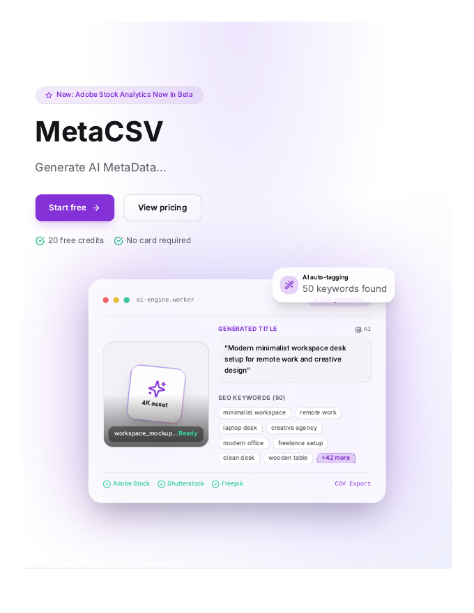
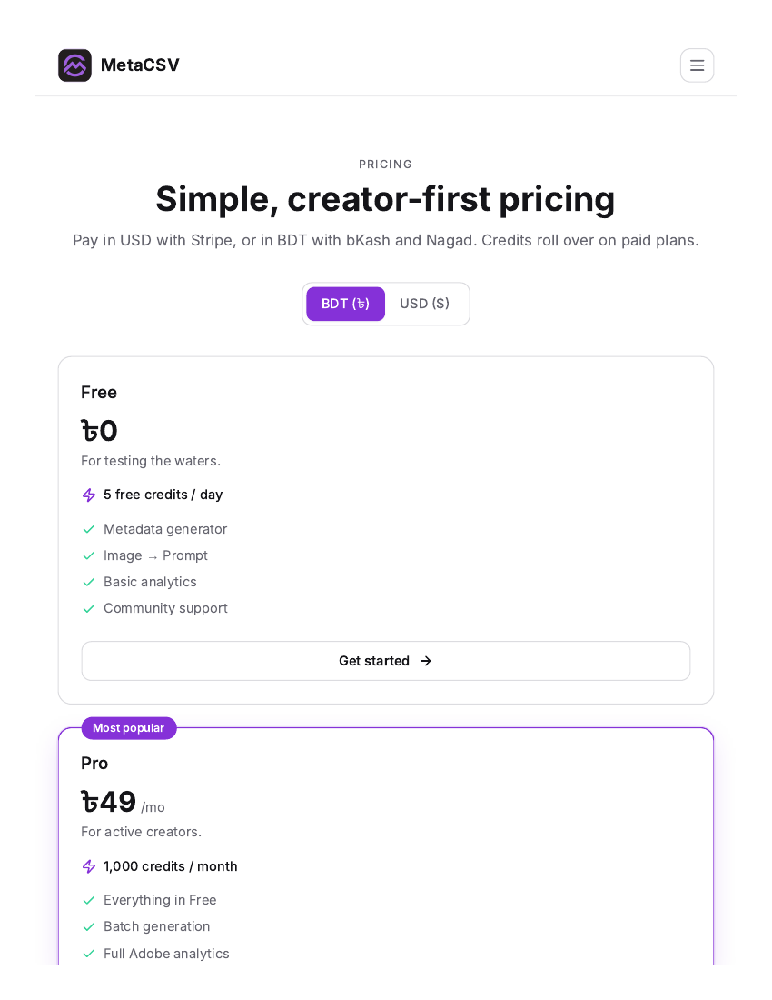
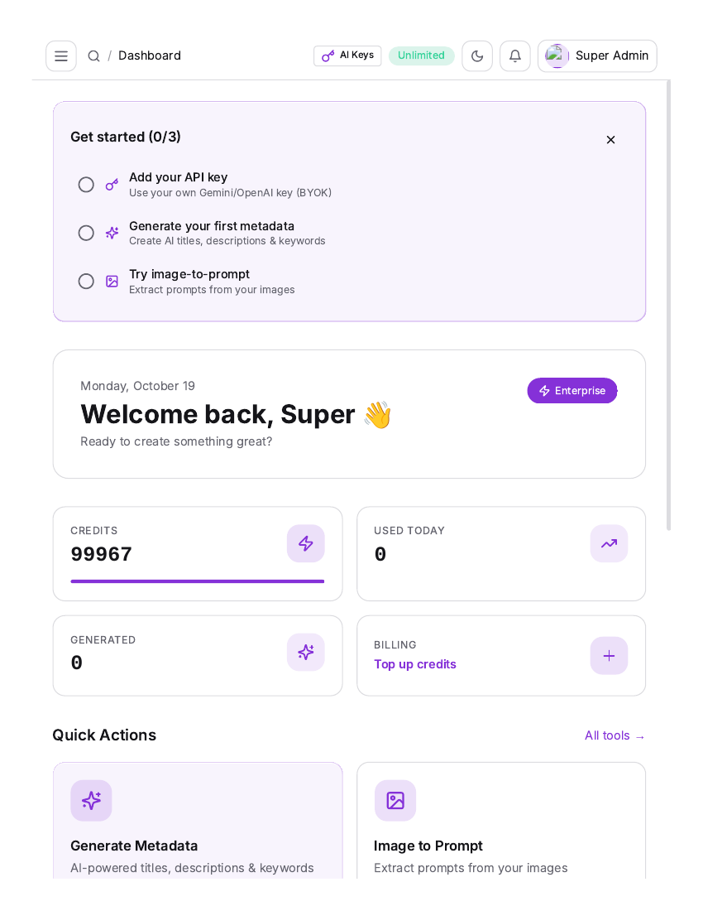
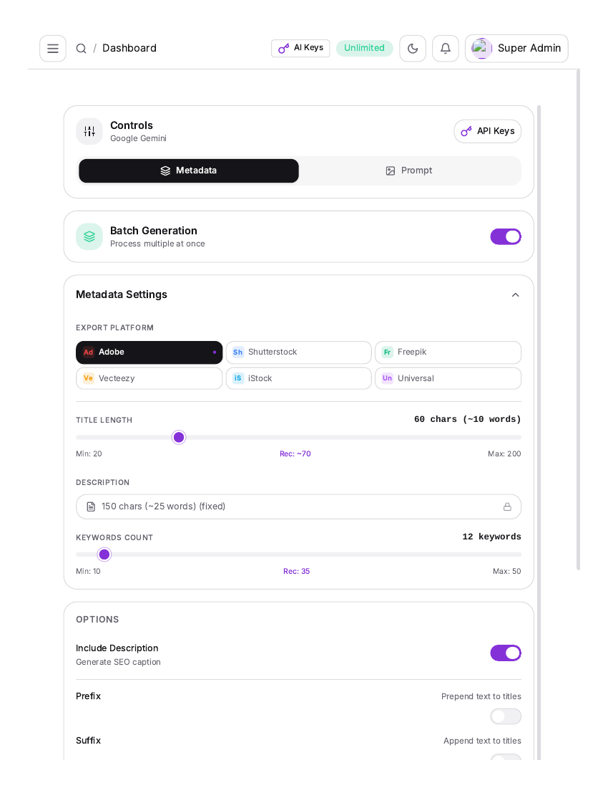
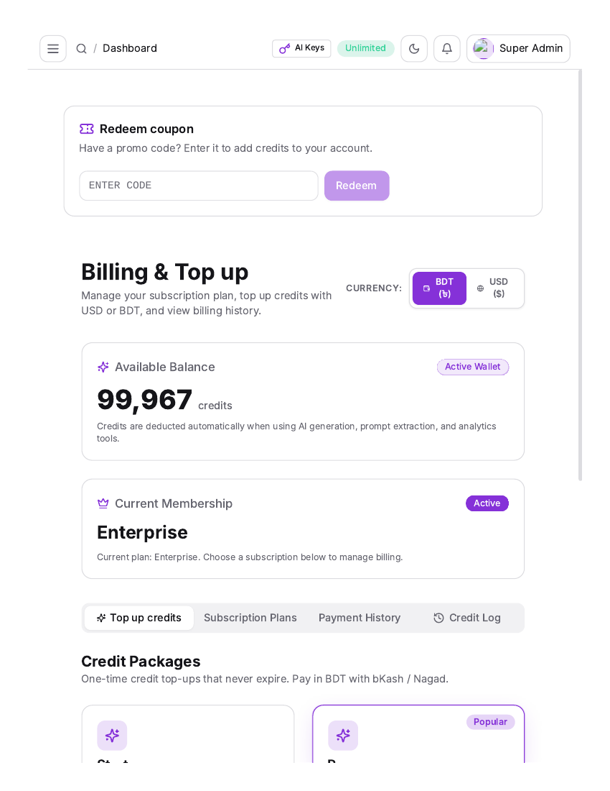
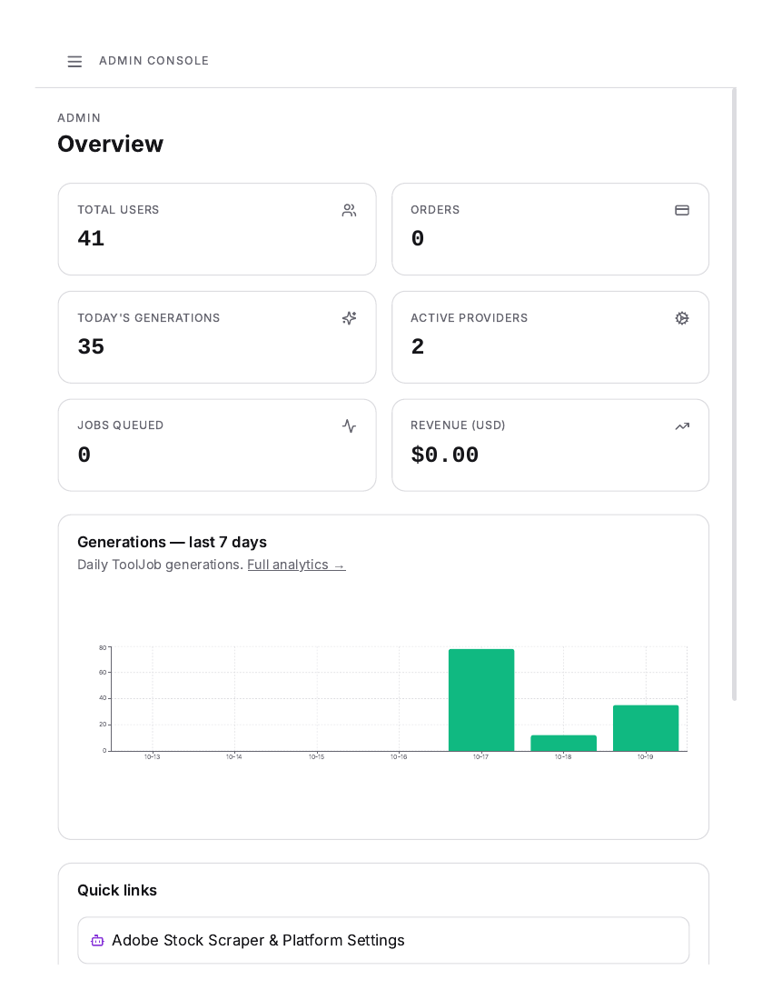

# 🚀 MetaCSV

[](https://nextjs.org/)
[](https://www.typescriptlang.org/)
[](https://tailwindcss.com/)
[](https://www.prisma.io/)
[](https://www.postgresql.org/)
[](LICENSE)

**MetaCSV** is an AI-powered metadata generation platform built for stock-content creators, photographers, vector artists, and digital studios. Generate SEO-optimized titles, descriptions, and keywords for Adobe Stock, Shutterstock, Freepik, and more — or reverse-engineer any image into a production-ready AI prompt.

🌐 **Live:** [https://metacsv.reflecters.com](https://metacsv.reflecters.com)

---

## 📸 Screenshots

| Homepage | Pricing |
|---|---|
|  |  |

| Dashboard | Generate |
|---|---|
|  |  |

| Billing | Admin Panel |
|---|---|
|  |  |

---

## ✨ Features

### 🎯 AI Metadata Generation
- **Batch processing** — upload up to 100 images at once
- **Platform presets** — titles, descriptions & keywords tuned for Adobe Stock, Shutterstock, Freepik, Vecteezy, iStock
- **CSV export** — ready for direct upload to contributor portals

### 🎨 Image-to-Prompt
- Reverse-engineer any image into detailed AI prompts
- 4 styles: Descriptive, Midjourney tags, Stable Diffusion tags, Cinematic
- Real-time streaming generation

### 🧰 19 Micro-Tools
Background remover, Bento builder, Color palette, ASCII vision, Adobe keywords, AI/EPS to JPG, Halftone studio, Dither studio, Image to PSD, Keyword clustering, Title A/B testing, Alt text generator, Keyword density, Contrast checker, Batch export, Adobe Analytics, and more.

### 🔑 BYOK (Bring Your Own Key)
Use your own Gemini, Grok, or OpenAI API keys. Admin can enforce BYOK or provide shared keys.

### 💳 Credits & Payments
- Credit wallet with daily free grants
- Stripe (USD) + bKash/Nagad (BDT) manual payments
- Coupon system with usage tracking
- Membership tiers: Free, Pro, Plus, Agency, Enterprise

### 🛡️ Admin Panel
User management, plans, credit packages, payments queue, AI provider routing, tool registry, homepage CMS, notifications, analytics, audit log, prompt styles.

---

## 🛠️ Tech Stack

| Layer | Technology |
|---|---|
| Framework | Next.js 14 (App Router) |
| Language | TypeScript |
| Styling | Tailwind CSS, shadcn/ui, Radix UI |
| Database | PostgreSQL + Prisma ORM |
| Auth | NextAuth.js (Credentials + Google OAuth) |
| Queue | BullMQ + Redis |
| Storage | S3-compatible (AWS S3 / MinIO / R2) or local |
| Payments | Stripe, bKash, Nagad |
| AI | Google Gemini, OpenAI, xAI Grok |

---

## 🚀 Run Locally

### Prerequisites
- **Node.js** ≥ 20
- **Docker** & Docker Compose (for PostgreSQL, Redis, MinIO)
- A **Gemini API key** (free at [aistudio.google.com](https://aistudio.google.com))

### Step 1 — Clone
```bash
git clone https://github.com/jahidbinsabit/meta-pilot.git
cd meta-pilot
```

### Step 2 — Install dependencies
```bash
npm install
```

### Step 3 — Start infrastructure
This starts PostgreSQL (port 5440), Redis (port 6379), and MinIO (ports 9000/9001):
```bash
docker compose up -d db redis minio
```

### Step 4 — Configure environment
```bash
cp .env.example .env
```

Edit `.env` and set at minimum:
```env
DATABASE_URL="<redacted>"
NEXTAUTH_SECRET="generate-a-64-char-random-string"
NEXTAUTH_URL="http://localhost:3000"
GEMINI_API_KEY="<redacted>"
```

> 💡 Generate a secret with: `openssl rand -base64 48`

### Step 5 — Setup database
```bash
# Create tables
npm run db:push

# Seed plans, tools, prompt styles, and admin settings
npm run db:seed
```

### Step 6 — Create your admin account
1. Start the dev server: `npm run dev`
2. Open [http://localhost:3000/signup](http://localhost:3000/signup) and register
3. Promote yourself to admin:
```bash
npx prisma studio
# → open the User table → set your user's role to ADMIN
```
4. Visit [http://localhost:3000/admin](http://localhost:3000/admin)

### Step 7 — Start developing
```bash
npm run dev
```
Open [http://localhost:3000](http://localhost:3000) 🎉

---

## 🔑 Environment Variables

| Variable | Required | Description |
|---|---|---|
| `DATABASE_URL` | ✅ | PostgreSQL connection string |
| `NEXTAUTH_SECRET` | ✅ | 64-char random string for session encryption |
| `NEXTAUTH_URL` | ✅ | App URL (`http://localhost:3000`) |
| `GEMINI_API_KEY` | ✅ | Google Gemini API key (or use BYOK in settings) |
| `OPENAI_API_KEY` | ❌ | OpenAI API key |
| `GOOGLE_CLIENT_ID` / `GOOGLE_CLIENT_SECRET` | ❌ | Google OAuth credentials |
| `REDIS_URL` | ❌ | Redis URL (defaults to `redis://localhost:6379`) |
| `S3_ENDPOINT`, `S3_BUCKET`, `S3_ACCESS_KEY_ID`, `S3_SECRET_ACCESS_KEY` | ❌ | S3 storage (or set `USE_LOCAL_STORAGE=true` for local files) |
| `STRIPE_SECRET_KEY`, `STRIPE_WEBHOOK_SECRET` | ❌ | Stripe payments |
| `SMTP_HOST`, `SMTP_USER`, `SMTP_PASSWORD` | ❌ | Email (verification, receipts) |
| `ADOBE_STOCK_API_KEY` | ❌ | Adobe Analytics module |

See [.env.example](.env.example) for the full list.

---

## 🧪 Testing

```bash
# Unit tests (Vitest)
npm run test

# Watch mode
npm run test:watch

# Type check
npx tsc --noEmit

# Lint
npm run lint
```

---

## 📁 Project Structure

```
meta-pilot/
├── app/                    # Next.js App Router
│   ├── (app)/dashboard/    # User dashboard pages
│   ├── admin/              # Admin panel pages
│   └── api/                # API routes (generate, payments, tools, cron)
├── components/             # React components
│   ├── admin/              # Admin UI
│   ├── dashboard/          # Dashboard UI
│   └── ui/                 # shadcn/ui primitives
├── lib/                    # Core logic
│   ├── ai/                 # AI provider clients (Gemini, OpenAI, Grok)
│   ├── credits/            # Credit engine (charge, refund, ledger)
│   ├── payments/           # Stripe + manual payment flows
│   └── queue/              # BullMQ worker
├── prisma/                 # Schema, migrations, seed
├── public/                 # Static assets + screenshots
├── tests/                  # Vitest test files
├── docker-compose.yml      # Local dev stack
├── docker-compose.prod.yml # Production stack
└── deploy-vps.sh           # One-command VPS deploy script
```

---

## 🐳 Production Deploy (VPS + Docker)

On a fresh Ubuntu VPS with Docker:

```bash
curl -fsSL https://raw.githubusercontent.com/jahidbinsabit/meta-pilot/main/deploy-vps.sh | bash
```

This clones the repo to `/opt/metapilot`, builds the Docker stack (app + PostgreSQL + Redis), and installs cron jobs (daily credit grants, upload cleanup). Point your reverse proxy (Nginx/CyberPanel) at `127.0.0.1:3100`.

---

## 🤝 Contributing

1. Fork the repo
2. Create a feature branch: `git checkout -b feature/my-feature`
3. Run tests: `npm run test` and `npx tsc --noEmit`
4. Commit and push, then open a Pull Request

---

## 👨‍💻 Built by

**Md Jahid Bin Sabit** — WordPress Security Specialist & Full-Stack Developer

- 🌐 [jbsabit.com](https://jbsabit.com)
- 💼 [LinkedIn](https://linkedin.com/in/jahidbinsabit)
- 🐙 [GitHub](https://github.com/jahidbinsabit)

---

## 📄 License

This project is licensed under the [MIT License](LICENSE).
